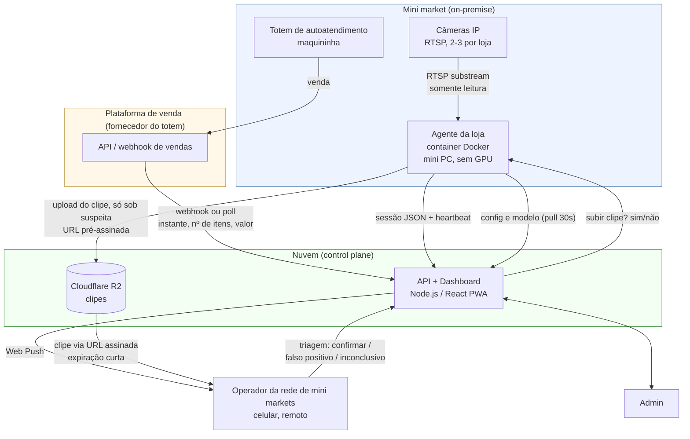
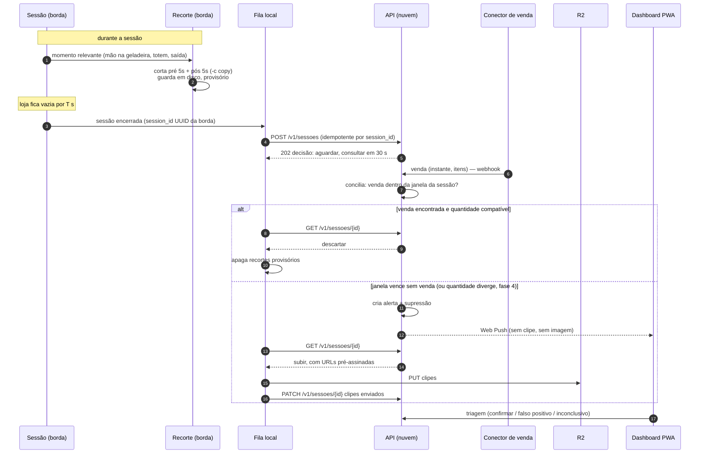
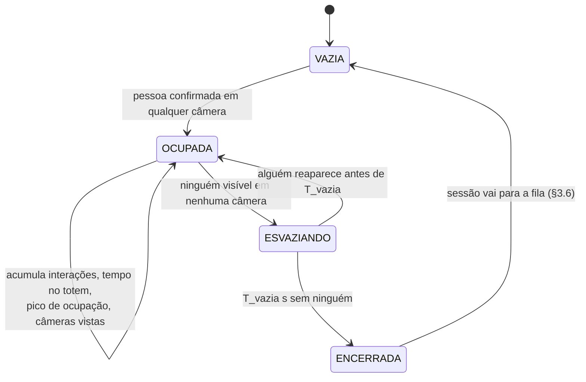
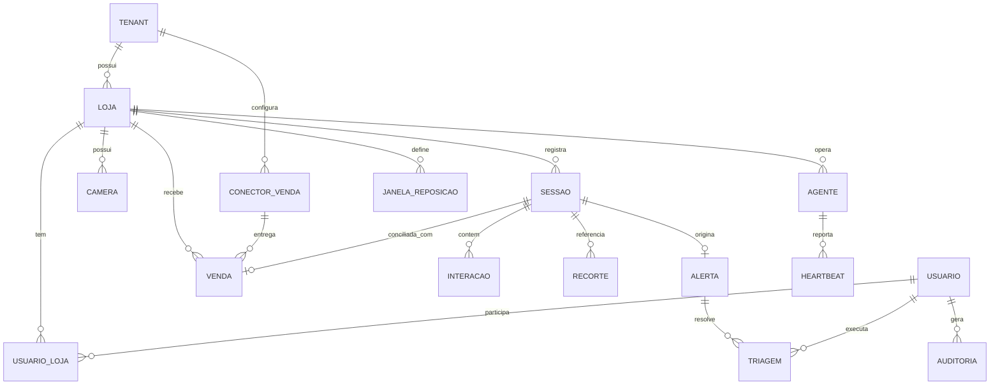

# Arquitetura — Detecção de Furto em Mini Markets Autônomos de Condomínio

**Status:** arquitetura pretendida, revista para o novo foco de produto. Boa parte da borda
(§3) e da nuvem (§4, §5) já é código do foco anterior e continua valendo; o que muda está
marcado e o plano de transição está na §11
**Escopo:** MVP / v1
**Última atualização:** 2026-11-16

> Este documento descreve a arquitetura **pretendida**, e continua sendo o alvo, não o
> retrato. O estado por componente vive no `CLAUDE.md`, que é atualizado a cada fatia;
> este documento não é o lugar de acompanhar progresso.
>
> Todos os limiares numéricos aqui são **hipóteses de projeto**, não medições. Onde
> aparece "a validar por benchmark", o número existe para dimensionar decisões e precisa
> ser confirmado com hardware e vídeo reais antes de virar contrato. Até hoje o sistema
> nunca viu vídeo de loja real.

---

## 0. O que mudou em relação à versão anterior

A versão anterior mirava **mercados de bairro**: ~20 câmeras, 6 a 10 relevantes, loja
cheia, caixa com funcionário e um box com GPU. O foco agora é o **mini market autônomo
de condomínio**: loja pequena, sem funcionário, 2 a 3 câmeras, pagamento no totem de
autoatendimento, e o hardware tem que ser um PC fraco, com placa de vídeo fraca ou sem
placa nenhuma.

A mudança de cliente muda o problema em quatro pontos, e é deles que sai o resto do
documento:

| O que mudou | Consequência na arquitetura |
|---|---|
| **Existe registro de venda.** O totem sabe o que foi pago e quando | A suspeita visual é conferida contra a venda antes de virar alerta (§3.5, §4.7). É a maior alavanca contra falso positivo que o projeto já teve — no foco anterior a integração com PDV estava fora de escopo |
| **Quase sempre há uma pessoa (ou um grupo) por vez** | A unidade de análise deixa de ser o *track* e passa a ser a **sessão**: da loja ocupada à loja vazia (§3.4). Isso dispensa re-identificação entre câmeras e rebaixa o risco de troca de ID (R-2) |
| **2 a 3 câmeras e nenhuma GPU garantida** | CPU vira o alvo, não o fallback: modelo menor, inferência só com movimento, OpenVINO em CPU Intel (§3.2, §3.8) |
| **Ninguém na loja para abordar** | O alerta não precisa chegar em 15 s; precisa chegar certo. O orçamento de latência relaxa para minutos e paga a espera pela venda (§3.7) |

O que **não** mudou: o sistema não decide nada sozinho, vídeo contínuo nunca sai da loja
nem é gravado, configuração é puxada pela borda, e toda decisão passa por triagem humana.

---

## 1. Visão geral e princípio organizador

O sistema detecta situações de possível furto em mini markets autônomos de condomínio,
reaproveitando as câmeras já instaladas (ou 2 a 3 câmeras IP baratas, quando não há).
Os comportamentos-alvo, em ordem de viabilidade:

1. **Saiu sem pagar** — a sessão teve interação com produto e nenhuma venda aconteceu.
2. **Pegou produto e não pagou** — o mesmo caso visto do lado do produto: a mão entrou
   na geladeira ou na gôndola e não houve venda. Na arquitetura, 1 e 2 são **uma regra
   só** (§3.4, Regra S): "saiu sem passar no totem" sem ter pegado nada não é furto, é
   morador que olhou e desistiu.
3. **Pegou N e pagou menos que N** — divergência de quantidade. É o mais difícil, e
   entra em fases: primeiro como **informação na triagem e métrica**, só depois como
   alerta (§3.4, Regra D).

O sistema **não decide nada sozinho**. Ele produz um *alerta* com os metadados da
sessão e clipes curtos, e um humano confirma ou descarta. Isso é requisito de produto e
de conformidade: não existe caminho no sistema em que uma detecção automática produza
consequência sem triagem humana. Num condomínio isso pesa mais que num mercado de
bairro: quem é apontado é um vizinho (R-10).

### Princípio organizador

**A borda vê e suspeita; a nuvem confere a venda; um humano decide.**

- O vídeo **nunca sai da loja**. O que sobe é a sessão (JSON, poucos KB) e, **só quando
  a suspeita sobrevive à conferência da venda**, os clipes curtos dela.
- A borda é autônoma: com a internet caída, ela continua ingerindo, detectando, montando
  sessões e cortando clipes. A nuvem é o plano de controle, administração e conciliação.
- A venda é conferida **na nuvem**, porque é lá que ela chega: as plataformas de
  autoatendimento entregam venda por webhook ou API na nuvem delas, não na rede da loja.
  E o dado de venda não precisa ir para o box (minimização, R-9).
- A nuvem detém a verdade sobre *configuração* (zonas, limiares, câmeras, usuários,
  versão de modelo, conectores de venda) e sobre o *histórico* (sessões, alertas,
  triagens, auditoria).

### Consequências diretas do princípio

| Consequência | Implicação prática |
|---|---|
| Vídeo contínuo nunca é gravado nem transmitido | Buffer circular em RAM; só os recortes em torno de momentos da sessão são persistidos, e só até a conciliação |
| Clipe de cliente honesto nunca sobe | A subida do clipe é **condicionada** à decisão da nuvem (§3.5). O recorte provisório é apagado da loja assim que a venda é encontrada |
| Custo de nuvem quase independente do número de câmeras | Nuvem escala com nº de *sessões*, não de *frames* |
| Link da loja não é ponto único de falha da detecção | Fila local + reenvio idempotente; sem link, a conciliação espera, a detecção não |
| CAPEX por loja baixo | Mini PC sem GPU (§3.8) |

### Requisitos não funcionais que dirigem a arquitetura

| # | Requisito | Onde é resolvido |
|---|---|---|
| NFR-1 | Fim da sessão → alerta no celular em ≤ 3 min | Janela de conciliação + upload direto do clipe (§3.7). **Era 15 s**: sem ninguém na loja para abordar, chegar certo vale mais que chegar rápido |
| NFR-2 | ≤ 3 alertas falsos **por loja** por dia | Conferência com a venda + regras por sessão + supressão (§3.4, §4.6). **Era por câmera**: o alerta agora nasce da sessão, que atravessa câmeras |
| NFR-3 | Nunca gravar vídeo contínuo | Buffer circular em RAM; recortes provisórios só em torno de momentos da sessão (§3.5) |
| NFR-4 | Sem dado biométrico | Modelos só emitem caixas de pessoa e juntas do corpo; sem embedding facial, sem re-identificação (§9) |
| NFR-5 | Inferência implantável em nuvem **ou** on-premise sem mudar código | Serviço em container, configuração 100% externa (ADR-001) |
| NFR-6 | Isolamento estrito entre tenants | `tenant_id` obrigatório em toda query; credencial de agente e de conector escopada à loja |
| NFR-7 | Clipes só por URL assinada de expiração curta | R2 com presigned URL; emissão registrada em auditoria |
| NFR-8 | Funcionar com internet instável | Fila local durável + backoff + idempotência (§3.6, §5.4) |
| NFR-9 | Triagem em ≤ 2 toques no celular | PWA com fila de triagem e ações primárias fixas (§4.5) |
| NFR-10 | **Rodar em mini PC sem GPU com 3 câmeras** | Modelo pequeno, portão de movimento, OpenVINO (§3.2, §3.8) |

---

## 2. Diagramas

### 2.1 Diagrama de contexto

O vídeo bruto existe apenas dentro da caixa `LOJA`. A única mídia que cruza a fronteira
são os clipes de uma sessão que **continuou suspeita depois de conferida a venda**.

O totem não fala com o agente. A venda entra pela nuvem, pelo conector do fornecedor
(§4.7). Um totem que só funcionasse falando com o box obrigaria uma integração por
modelo de maquininha dentro da loja, que é o trabalho que tirou o PDV do escopo da
versão anterior.

### 2.2 Diagrama de componentes

```mermaid
flowchart LR
    subgraph EDGE["Agente da loja — docker compose, mini PC"]
        direction TB

        subgraph PIPE["Pipeline (pipes and filters)"]
            direction TB
            S1["1. Ingestão<br/>1 ffmpeg por câmera<br/>decode em CPU / QSV"]
            S1b["Portão de movimento<br/>diferença de frames, barato"]
            S2["2. Detecção<br/>YOLOX-nano/tiny, OpenVINO<br/>só com movimento ou track ativo"]
            S3["3. Tracking<br/>ByteTrack por câmera"]
            S3b["Pose (opcional)<br/>só perto de zona de produto"]
            S4["4a. Sessão<br/>ocupação da loja inteira"]
            S5["4b. Regras da sessão<br/>interação com produto, totem, saída"]
            S6["5. Recorte provisório<br/>buffer 30s em RAM<br/>corte -c copy por momento"]
            S1 --> S1b --> S2 --> S3
            S3 --> S3b
            S3 --> S4
            S3b --> S4
            S4 --> S5
            S5 -->|"momento relevante"| S6
        end

        SUP["Supervisor / uploader"]
        QL[("Fila local durável<br/>Redis")]
        TS["Tailscale<br/>acesso remoto"]

        S5 -->|"sessão encerrada"| QL
        S6 -->|"recortes pendentes"| QL
        QL --> SUP
    end

    subgraph CLOUD["Control plane"]
        direction TB
        APIF["API Fastify<br/>não recebe vídeo"]
        CONC["Conciliador<br/>sessão × venda"]
        CONV["Conectores de venda<br/>um por fornecedor"]
        PG[("PostgreSQL")]
        PUSH["Web Push"]
        APIF --> PG
        CONV --> PG
        CONC --> PG
        CONC --> PUSH
    end

    R2[("Cloudflare R2")]
    PWA["Dashboard React PWA"]
    FORN["Plataforma de venda"]

    SUP -->|"POST /v1/sessoes<br/>POST /v1/agents/heartbeat"| APIF
    SUP -->|"GET /v1/sessoes/{id}<br/>subir ou descartar"| APIF
    SUP -->|"GET /v1/agents/config (30s)"| APIF
    SUP -->|"PUT clipe (presigned)"| R2
    FORN -->|"webhook / poll"| CONV
    TS -.->|"suporte / debug"| EDGE
    APIF <--> PWA
    R2 -->|"GET assinado"| PWA
```

### 2.3 Sequência: da saída da loja ao alerta no celular

O aviso no celular sai **antes** de os clipes terminarem de subir, como na versão
anterior. A diferença é o que acontece antes dele: a nuvem espera a venda.

---

## 3. Detalhamento da borda

Um agente por loja, em container Docker, num **mini PC sem GPU** dentro da loja (§3.8).
O agente é um pipeline de estágios com filas entre eles (*pipes and filters*): cada
estágio tem uma responsabilidade única, consome de uma fila e produz em outra, e pode
ser instrumentado e substituído isoladamente.

**Container por loja, não por câmera** (ADR-007). As câmeras compartilham o mesmo
processo e a mesma sessão de inferência, para não carregar o modelo três vezes na RAM.

**Cobertura é requisito de instalação.** Com 2 a 3 câmeras, cada uma tem papel fixo, e
a loja só é elegível se o checklist de qualificação (R-3) fechar:

| Câmera | O que precisa enxergar | Para quê |
|---|---|---|
| **A — porta e totem** | A porta inteira e a tela/bancada do totem | Entrada, saída e tempo no totem. Numa loja pequena cabem no mesmo quadro, e é o arranjo preferido |
| **B — produtos** | As portas das geladeiras e a frente das gôndolas | Interação com produto |
| **C — opcional** | O que A e B não cobrem; numa fase futura, o totem visto de cima (Regra D) | Cobertura sem ponto cego |

A regra de ouro da instalação: **não pode haver lugar na área de venda onde uma pessoa
fique invisível para todas as câmeras.** A sessão (§3.4) termina quando ninguém é visto
em nenhuma câmera; um ponto cego encerra a sessão com alguém dentro da loja.

### 3.1 Estágio 1 — Ingestão

**Responsabilidade.** Um processo `ffmpeg` por câmera lendo o **substream** RTSP
(640x480 ou próximo). Decode em CPU, ou em hardware (Intel Quick Sync via VAAPI/QSV,
NVDEC quando houver placa NVIDIA) quando disponível. Entrega frames decodificados com
*timestamp* monotônico da borda.

Usar o substream é deliberado: resolução suficiente para triagem e para uma pessoa a
poucos metros, e decode barato. Três substreams SD a 15 fps cabem no decode em software
de um mini PC da classe N100; **a validar por benchmark**. Se não couberem, a primeira
alavanca é configurar a própria câmera para entregar menos fps no substream — decode é
gasto em todo frame que chega, não só nos que vão para a inferência.

**Ponto crítico:** a amostragem do estágio 2 economiza **inferência**, não decode. O
dimensionamento de CPU para decode deve ser feito sobre a taxa cheia que a câmera
entrega.

**Falhas esperadas**

| Falha | Comportamento |
|---|---|
| Câmera offline / RTSP recusa conexão | Reconexão com backoff exponencial + jitter; após limiar, alerta técnico de câmera offline |
| Stream trava sem fechar a conexão | *Watchdog* por ausência de frame novo; mata e recria o processo ffmpeg |
| Câmera muda de IP (DHCP) | Falha de conexão tratada como offline; resolução manual via configuração |
| Corrupção de pacotes / pixelação | Frames inválidos descartados; taxa de descarte vai no heartbeat |
| Relógio da câmera fora de sincronia | Timestamp de referência é o da borda, nunca o da câmera |
| **Uma câmera da loja offline** | **A sessão fica cega num pedaço da loja.** Sessões abertas enquanto alguma câmera está offline são marcadas `cobertura_parcial`, e a Regra S não alerta sobre elas sem conferência de venda (§3.4) |

### 3.2 Estágio 2 — Detecção

**Responsabilidade.** Rodar o detector de pessoas sobre frames amostrados e emitir
caixas com confiança. O modelo responde apenas **onde estão as pessoas** — não avalia
intenção, não classifica comportamento, não identifica indivíduos.

**CPU é o alvo, não o fallback.** Na versão anterior, a medição numa máquina sem GPU
fechou a questão para o lado oposto: YOLOX-s a 640 custa ~450 ms por frame em CPU, ou
seja ~2 fps para **uma** câmera, e com o tracking na mesma thread a taxa cai para
~1,15 fps (§10). Isso não sustenta nem uma câmera. Três decisões juntas mudam a conta:

1. **Modelo menor.** YOLOX-nano ou YOLOX-tiny, entrada 416. Pelos números publicados do
   YOLOX, o nano faz ~1 GFLOP e o tiny ~6,5 GFLOPs, contra ~27 do s a 640: de 4 a 25
   vezes menos conta. Numa loja pequena, bem iluminada, com uma pessoa a poucos metros
   da câmera, o recall de modelo pequeno é o caso favorável — mas é **hipótese a validar
   com vídeo de mini market real**, e a escolha entre nano e tiny sai desse benchmark.
   Continua YOLOX, pela licença (Apache-2.0, ADR-009) e pela convenção de
   pré-processamento já implementada e testada.
2. **Portão de movimento.** A loja passa a maior parte do dia vazia. Antes do detector,
   uma diferença de frames em escala de cinza reduzida (custo desprezível) decide se há
   o que olhar. A inferência roda quando há movimento **ou** quando há track ativo na
   câmera — uma pessoa parada escolhendo na geladeira mexe pouco, e o track ativo é o
   que impede o portão de cegá-la. Com o portão fechado, a câmera ainda passa por uma
   inferência de vigia a cada poucos segundos, para que uma pessoa imóvel desde o início
   não fique invisível.
3. **OpenVINO em CPU Intel.** O ONNX Runtime tem o `OpenVINOExecutionProvider`. A troca é
   de configuração, na mesma lista ordenada de *execution providers* que já existe — não
   há `if gpu` nem `if intel` no código (§3.9). O provider que de fato pegou continua
   indo no heartbeat, porque pedido não é obtido.

**A taxa de amostragem continua 3 fps por câmera ativa** (ADR-005). Com o portão de
movimento, o custo médio é muito menor que 3 fps × 3 câmeras; o custo de pico, com a
loja ocupada, é o que dimensiona o hardware. **A validar por benchmark** no mini PC de
referência.

**A placa de vídeo continua suportada, como opcional.** Uma loja com GPU NVIDIA usa a
imagem com CUDA e o provider de CUDA; nada mais muda.

**A licença do runtime não é a licença do modelo.** O ONNX Runtime e o OpenVINO são
permissivos, mas pesos da linhagem Ultralytics são AGPL-3.0. Trocar o modelo alvo é
trocar a licença junto, e a convenção de pré-processamento também (`PreprocessSpec`).

**Falhas esperadas**

| Falha | Comportamento |
|---|---|
| Fila de entrada crescendo (CPU saturada) | Descarte do frame mais antigo; profundidade e descartes no heartbeat |
| Portão de movimento fechado com alguém parado | Inferência de vigia periódica; track ativo mantém o portão aberto |
| Mudança de luz (porta abrindo, lâmpada) abre o portão | Custo de inferência desperdiçado, não erro; a contagem de aberturas sem pessoa vai no heartbeat |
| Inferência levanta exceção | Contada em `errors` e seguida em frente; a thread é uma só para o agente (ADR-007) |
| Modelo novo pior que o anterior | Rollback de versão comandado pela nuvem (ADR-006) |

### 3.3 Estágio 3 — Tracking

**Responsabilidade.** ByteTrack com filtro de Kalman e atribuição ótima, associando
detecções entre frames e atribuindo um ID por pessoa **dentro daquela câmera**. Sem
re-identificação entre câmeras e sem característica biométrica: o ID é local, efêmero e
descartado ao fim do track.

**O risco deste estágio caiu.** No mercado de bairro, uma troca de ID num cruzamento de
pessoas fazia alguém "nascer" na saída sem histórico, e isso era a causa raiz mais
provável de falso positivo. No mini market, a regra não depende mais da história de
**um** track (§3.4): ela depende da sessão inteira. Uma troca de ID dentro da sessão não
muda o que a sessão viu.

As lições já pagas continuam valendo, porque a 3 fps a física é a mesma:

- **O `dt` do filtro é tempo real, não "um frame".** A fila do §3.2 descarta, e com o
  portão de movimento os intervalos variam ainda mais.
- **Os limiares de IoU precisam ser mais frouxos** que os das implementações de
  referência, que assumem 30 fps. Uma pessoa andando tem IoU de ~0,19 entre caixas cruas
  consecutivas a 3 fps.
- **Detecção fraca nunca cria track**; só continua um existente.
- **Toda janela de tempo é configurada em segundos**, não em frames.

**Falhas esperadas**

| Falha | Comportamento |
|---|---|
| Troca de ID | Sem efeito na Regra S, que olha a sessão; ruído na contagem de interações da Regra D |
| Reconexão da câmera no meio de um track | Tracks daquela câmera encerrados; a sessão continua se outra câmera ainda vê alguém |
| Track perdido por oclusão | Track expira; reaparição vira track novo — na mesma sessão |
| Objeto estático detectado como pessoa | Tempo mínimo de vida antes de contar como ocupação; uma sessão que "nunca fecha" vai no heartbeat como alerta técnico |

### 3.4 Estágio 4 — Sessão e regras

O estágio tem duas metades: a **sessão**, que diz quando a loja esteve ocupada e o que
aconteceu nela, e as **regras**, que dizem se ela é suspeita. A numeração é a mesma do
motor de regras do foco anterior porque o código cita §3.4 para ele, e é dele que este
estágio descende.

#### A sessão

**Responsabilidade.** Transformar o que as câmeras veem em **sessões**: o intervalo em
que a loja está ocupada, de quando alguém aparece a quando a loja fica vazia. **É a
decisão central desta revisão** (ADR-010).

O motivo é o que o comportamento-alvo exige: "pegou produto e não pagou" junta duas
câmeras — a mão na geladeira aparece na câmera B, o totem e a porta na câmera A. Ligar
as duas exigiria saber que a pessoa da B é a mesma da A, que é re-identificação entre
câmeras — fora do escopo pelo risco de tracking e por ser a porta para biometria (§9). A
sessão contorna isso: numa loja de condomínio, quase sempre há uma pessoa por vez, e
então "a pessoa" e "a loja ocupada" são a mesma coisa. Quando não são — uma família, dois
vizinhos —, a sessão trata o grupo como uma unidade. Isso tem um custo, e ele é assumido
na Regra S (§3.4).

O que a sessão acumula, e que vai no payload:

| Campo | De onde vem | Uso |
|---|---|---|
| `inicio`, `fim` | Primeira e última pessoa vista | Janela de conciliação com a venda |
| `ocupacao_max` | Maior número de tracks simultâneos na loja (ver nota) | Distinguir pessoa sozinha de grupo |
| `interacoes[]` | Estágio 5: cada entrada em zona de produto, com câmera, zona e instante | Regra S e Regra D |
| `tempo_totem_s` | Tempo acumulado na zona do totem | Regra S sem conector de venda |
| `travessias` | Entradas e saídas pela linha da porta | Coerência da sessão; heartbeat |
| `cobertura_parcial` | Alguma câmera offline durante a sessão | A Regra S fica mais conservadora |
| `recortes[]` | Estágio 6: os momentos cortados, ainda na loja | O que a nuvem pode pedir para subir |

**Ocupação sem re-identificação.** A mesma pessoa pode aparecer em duas câmeras ao mesmo
tempo, então somar tracks das câmeras superestima. `ocupacao_max` é o maior número de
tracks **numa mesma câmera** no mesmo instante — um limite inferior honesto. Para decidir
"sozinho ou em grupo" ele basta; para contar pessoas, não.

**Encerramento.** `T_vazia` (candidato: 20 s) protege contra a pessoa agachada atrás da
gôndola que some de todas as câmeras por alguns segundos. Curto demais parte uma visita
em duas — e a segunda metade, sem venda, vira suspeita. Longo demais junta o morador
seguinte na sessão anterior. **A validar com vídeo real.**

**Falhas esperadas**

| Falha | Comportamento |
|---|---|
| Ponto cego encerra a sessão com alguém dentro | Visita partida em duas; mitigação é instalação (cobertura total) e `T_vazia` |
| Dois moradores em visitas sobrepostas | Uma sessão só; uma venda pode conciliar a sessão de quem não pagou. **Falso negativo assumido** (§3.4) |
| Repositor ou faxineira | Sessão longa, muitas interações, sem venda. Tratado por **modo reposição** (§3.4) |
| Sessão que nunca fecha (objeto detectado como pessoa) | Teto de duração; ao atingi-lo, a sessão fecha e o heartbeat abre alerta técnico |

#### As regras da sessão

**Responsabilidade.** Detectar os momentos que importam dentro da sessão e, ao fim dela,
dizer se ela é suspeita **do ponto de vista da câmera**. A palavra final sobre a venda é
da nuvem (§4.7).

O motor continua **separado do modelo** (ADR-002): zonas, tempos e limiares são
configuração versionada por câmera. Recalibrar uma loja é mudar configuração.

##### Zonas

| Zona | Forma | O que detecta |
|---|---|---|
| `porta` | Linha orientada | Entrada e saída da loja |
| `totem` | Polígono | Tempo na frente do totem |
| `produto` | Polígono, com um **sinal** configurado | Interação com produto (abaixo) |
| `exclusao` | Polígono | Área ignorada (vitrine, reflexo, corredor do prédio visível pela porta) |

##### Interação com produto

É o sinal que separa "olhou e foi embora" de "pegou alguma coisa". Cada zona de produto
escolhe **como** detectá-lo, do mais barato ao mais caro, porque o que funciona numa
geladeira não funciona numa gôndola aberta:

| Sinal | Como | Custo | Onde serve |
|---|---|---|---|
| `porta_geladeira` | Mudança de pixels num polígono fixo sobre a porta da geladeira, com pessoa presente na câmera | Desprezível, sem modelo | Geladeiras de porta de vidro. É o sinal mais forte e mais barato do sistema |
| `pulso` | A pose (RTMPose, já integrada) coloca o punho dentro do polígono | Uma inferência de pose por pessoa perto da zona | Gôndolas abertas, cestos, expositores |
| `presenca` | A base da caixa da pessoa fica na frente da zona por ≥ N s | Nenhum além do tracking | Fallback, quando a pose não é viável; o mais fraco dos três |

A pose **só roda para tracks perto de uma zona de produto** com sinal `pulso`. Em CPU,
pose para todo mundo o tempo todo não cabe; pose para uma pessoa de cada vez, só quando
ela está na frente da gôndola, deve caber. **A validar por benchmark.**

O "gesto da bolsa" do piloto anterior (§11) continua desligado por padrão e **não gera
alerta**: no dataset de furto encenado, ele não separa furto de compra normal.

##### Regra S — sessão sem venda

Cobre os comportamentos 1 e 2 do §1. Na borda, a sessão é **candidata** quando teve ao
menos uma interação com produto. Sem interação, a sessão termina ali: morador que entrou,
olhou e saiu não é furto, e alertar sobre isso é falso positivo por definição.

O que acontece com a candidata depende de a loja ter conector de venda:

| Loja | Quem decide | Critério |
|---|---|---|
| **Com conector** (o caso-alvo) | A nuvem (§4.7) | Nenhuma venda na janela `[inicio - margem, fim + espera]` → alerta |
| **Sem conector** | A borda, como no foco anterior | `tempo_totem_s < N` → alerta, marcado `sem_venda_conferida` |

A loja sem conector existe para não travar uma instalação enquanto o fornecedor não
libera a API, mas é a versão fraca da regra: estar na frente do totem não é ter pago. Os
alertas dela levam marca própria e a métrica do R-1 os separa — misturá-los à regra
conferida esconderia, na média, justamente a loja que precisa do conector.

**Falso negativo assumido:** numa sessão em grupo, uma venda concilia a sessão inteira,
inclusive a de quem não pagou. Separar exigiria saber qual pessoa estava no totem e qual
na geladeira, entre câmeras — de novo re-identificação. O caso é aceito no v1, e a
frequência de sessões com `ocupacao_max > 1` vai na métrica para dizer se ele importa.

**Modo reposição.** Repositor e faxineira produzem exatamente a assinatura de furto:
muitas interações e nenhuma venda. O operador liga o modo pelo dashboard (ou ele vem de
uma janela de horário configurada), e sessões nesse intervalo não alertam. Mais simples
que reconhecer o funcionário, e sem biometria.

##### Regra D — divergência de quantidade (por fases)

Cobre o comportamento 3: pegou dois, pagou um. **Não entra como alerta no v1.** Contar
itens na mão de alguém por câmera de teto, em CPU, não é confiável, e um alerta não
confiável é o caminho mais curto para o R-1.

O que entra é a **coleta**:

- Cada sessão já sobe `interacoes[]`. A nuvem já recebe `itens` da venda.
- O alerta da Regra S e o evento conciliado mostram os dois números na triagem
  ("4 interações · 1 item pago") como **informação para o humano**, não como acusação.
- A métrica guarda a divergência por sessão. Com algumas semanas de triagem, dá para
  medir se "interações − itens ≥ k" separa furto de compra normal — do mesmo jeito que
  `tools/avalia_gesto.py` mediu o gesto da bolsa e o reprovou.

Só se essa medição aprovar a Regra D vira alerta. Se não aprovar, o caminho seguinte é
**uma câmera dedicada sobre o totem**, contando os produtos que passam pela bancada
contra os itens da venda — o que exige um detector de "produto na mão" treinado com
dataset próprio, hoje fora de escopo (§9).

**Falhas esperadas**

| Falha | Comportamento |
|---|---|
| Zona de produto mal desenhada | Interação nunca detectada: falso negativo silencioso. A taxa de sessões com zero interação **e** venda conciliada denuncia (§4.7) |
| Morador abre a geladeira, desiste e fecha | Interação sem retirada; sessão candidata, e a ausência de venda vira alerta. Falso positivo legítimo da regra, e o motivo de a Regra S precisar da triagem |
| Câmera reposicionada | Zonas fora do lugar; detectável por taxa anômala e recusado na subida quando a resolução muda (§10) |

### 3.5 Estágio 5 — Recorte provisório

**Responsabilidade.** Manter um buffer circular dos últimos 30 s por câmera **em RAM** e,
a cada momento relevante da sessão, cortar pré-roll e pós-roll com `ffmpeg` em modo
`copy`, sem re-encode. O corte continua sendo o do foco anterior; o que muda é **quando**
ele acontece e **o que se faz com ele**.

**Por que cortar durante a sessão, e não no fim.** Uma visita dura minutos. Quando a
loja esvazia, a mão na geladeira já saiu do buffer de 30 s há muito tempo. Então os
recortes nascem no instante de cada momento — interação com produto, passagem pelo
totem, saída — e esperam a decisão da nuvem no disco.

**Por que provisório.** Toda compra honesta também tem interação com produto. Se os
recortes subissem sempre, a nuvem guardaria o vídeo de todo morador que comprou um
refrigerante, o que viola a minimização (R-9) e o próprio princípio da §1. Os recortes
ficam **na loja** até a nuvem responder:

- **`descartar`** (venda encontrada) → os arquivos são apagados do disco.
- **`subir`** (suspeita mantida) → sobem por URL pré-assinada e são apagados após a
  confirmação, como hoje.
- **Sem resposta** (link caído) → ficam até o TTL local (candidato: 6 h), e então são
  apagados com registro. A sessão continua na fila; perde-se o vídeo, não o alerta.

**Teto por sessão.** No máximo K recortes (candidato: 4), de no máximo ~10 s cada:
priorizando a última interação com produto, a passagem pelo totem (ou a falta dela) e a
saída. Uma sessão de reposição não pode encher o disco.

**Vários clipes por alerta.** O contrato passa de um clipe por evento para uma lista
(§5.2). O dashboard os toca em sequência, e o primeiro toque continua abrindo o alerta
com o vídeo já rodando (NFR-9). Concatenar na borda pareceu mais simples, mas a
concatenação em `copy` exige parâmetros idênticos de codec, e duas câmeras de modelos
diferentes na mesma loja quebrariam isso em silêncio.

O buffer é **exclusivamente em RAM** e não há gravação contínua em disco em nenhum ponto
(NFR-3). O que existe em disco são recortes de momentos, com vida curta.

**Falhas esperadas**

| Falha | Comportamento |
|---|---|
| Momento perto do início do buffer | Pré-roll menor; registrado no recorte |
| Corte falha (keyframe ausente, container inválido) | A sessão segue sem aquele recorte, marcado `falhou`; o alerta não se perde |
| Disco cheio | Descarta o recorte provisório mais antigo; sessões sobrevivem sem vídeo |
| Reinício do container | Buffer em RAM perdido; recortes já em disco e sessões na fila sobrevivem |

### 3.6 Fila local e envio

A fila local é a do foco anterior (ADR-004): **Redis no próprio box**, com AOF, ZSET
como agenda de backoff, lease por script Lua, TTL e fila morta. O que muda é o que passa
por ela.

Cada sessão nasce com um **UUID gerado na borda** (`session_id`), que é a chave de
idempotência: reenviar a mesma sessão nunca cria duplicata na nuvem.

| Item | Ciclo |
|---|---|
| **Sessão** | `POST /v1/sessoes` → `202` com `decisao: aguardar` e quando consultar |
| **Consulta da decisão** | `GET /v1/sessoes/{id}` agendada no mesmo ZSET, até `subir` ou `descartar` |
| **Recortes** | Só entram na agenda de envio depois de `subir`; com `descartar`, são apagados |

A consulta da decisão é **puxada pela borda**, como tudo o mais (ADR-003). A nuvem nunca
abre conexão com a loja, então "pode apagar o vídeo" também é uma resposta a uma
pergunta da borda, nunca um comando empurrado.

- **Ordem de envio:** sessões primeiro, depois consultas, depois recortes.
- **TTL da sessão** (candidato: 24 h) e **TTL do recorte provisório** (candidato: 6 h)
  são distintos: o JSON da sessão é pequeno e ainda serve à métrica no dia seguinte; o
  vídeo de um morador não deve ficar no disco da loja esperando indefinidamente.

### 3.7 Orçamento de latência (hipótese)

NFR-1 exige ≤ 3 min do fim da sessão até o alerta no celular.

| Etapa | Orçamento proposto |
|---|---|
| `T_vazia` (fechamento da sessão) | ~20 s, fixo por definição |
| POST da sessão | a validar por benchmark |
| **Espera pela venda** (janela de conciliação) | candidato: 90 s após o fim da sessão |
| Consulta da decisão pela borda | até o intervalo de consulta (candidato: 15 s) |
| Upload dos recortes | a validar; o push sai antes |

A espera pela venda é o maior pedaço, e depende de quanto o webhook do fornecedor
atrasa — o primeiro dado a medir quando houver um conector (§10). Ela é o preço de
alertar certo, e num mini market sem funcionário ninguém ia abordar o morador na porta
de qualquer jeito: o alerta serve para o operador decidir depois, com o vídeo.

### 3.8 Composição do agente e hardware de referência

**Box de referência: mini PC x86 sem GPU**, classe Intel N100/N150 ou superior, 8 GB de
RAM (16 GB com folga), SSD de 128 GB ou mais, rede cabeada. Intel por causa do OpenVINO
e do Quick Sync. **O modelo exato sai do benchmark** (§10); a hipótese a derrubar é "3
câmeras com sessão e pose sob demanda num N100".

No `docker-compose` do box:

- **agente** — imagem **CPU** com ffmpeg, `onnxruntime` com OpenVINO e o agente. Versão
  fixa por loja no `.env`, nunca `latest` (R-7). A imagem CUDA atual
  (`apps/agent/Dockerfile`) continua existindo como variante para box com placa NVIDIA.
- **redis** — fila local (ADR-004), com AOF e sem porta publicada.

Fora do compose, por decisão:

- **tailscale** — no host, não em container: é a porta para consertar o box, e não pode
  depender do Docker que talvez seja o que quebrou (R-6). Condomínio também não tem IP
  fixo nem alguém para abrir porta no roteador.
- **atualização da imagem** — manual, por versão, até existir sinal de saúde local que
  permita rollback automático (R-7).

### 3.9 Portabilidade nuvem / on-premise (NFR-5)

O serviço de inferência é o mesmo artefato nos dois modos. Nada de `if cloud`, `if gpu`
ou `if intel`. O que muda é **configuração externa**: endpoint da API, origem dos
streams, lista de providers, credenciais.

---

## 4. Detalhamento do control plane

A nuvem administra cadastro, configuração, histórico, notificação, triagem — e agora
**conciliação com a venda**. **Ela não recebe vídeo de sessão que não seja suspeita.**

### 4.1 API — Node.js (Fastify + Prisma)

Autenticação e autorização, CRUD de lojas/usuários/câmeras/zonas, recepção de sessões e
heartbeats, recepção de vendas pelos conectores, conciliação, emissão de URLs
pré-assinadas, fila de triagem, métricas e auditoria. É o único ponto que fala com o
PostgreSQL.

### 4.2 PostgreSQL

Fonte da verdade de configuração e histórico. Toda tabela com dado de tenant carrega
`tenant_id`, e o acesso é sempre filtrado por ele (NFR-6).

### 4.3 Trabalho assíncrono

O v1 segue sem BullMQ, como hoje: Web Push é em processo e a decisão de notificar é
gravada antes do envio (R-11). A conciliação, porém, precisa de um relógio — "a janela
desta sessão venceu" — e esse relógio não pode morar só na memória do processo, senão
um reinício da API esqueceria as sessões esperando venda. O v1 resolve com uma varredura
periódica sobre o Postgres (`sessoes WHERE decisao = 'aguardar' AND janela_ate < now()`),
que é durável por construção. BullMQ entra quando houver um segundo canal pago
(WhatsApp) ou um job que precise de retry próprio.

### 4.4 Cloudflare R2

Armazena os clipes das sessões suspeitas. O agente sobe direto, por URL pré-assinada; a
leitura também é por URL assinada de expiração curta, e a emissão é auditada (NFR-7). A
chave do objeto é determinística a partir de `tenant_id`, dia e `session_id` — e agora
também do índice do recorte.

### 4.5 Dashboard

O uso principal agora é o **operador da rede de mini markets**, que cuida de várias
lojas de longe — não o gerente no corredor. A régua de dois toques (NFR-9) continua: um
toque abre o alerta com os clipes rodando em sequência; o segundo é a decisão —
confirmar, falso positivo ou inconclusivo — em botões grandes e fixos, do mesmo peso.

O alerta mostra o que a triagem precisa para não acusar errado: o horário da sessão, se
havia mais de uma pessoa, as interações por zona e, quando há conector, **"nenhuma venda
entre HH:MM e HH:MM"** ou **"N interações · M itens pagos"**. A linguagem é sempre
"possível ocorrência" (R-10).

Telas novas que o foco pede: **modo reposição** por loja (liga e desliga, com horário
programado) e **estado do conector de venda** (última venda recebida — um conector
parado faz toda sessão virar alerta).

### 4.6 Supressão de duplicados

1. **Idempotência** — `session_id` gerado na borda impede duplicata por reenvio.
2. **Teto e agrupamento do aviso** — o que já existe para o Web Push (teto diário por
   loja, agrupamento por gatilho, nada de tocar o celular por evento velho) continua
   valendo, agora com a loja como unidade.
3. **Conector parado não vira rajada.** Se a última venda recebida de uma loja é mais
   velha que um limite enquanto há sessões com interação, a nuvem para de alertar pela
   Regra S conferida, abre **alerta técnico de conector** e segura as sessões como
   pendentes. Sem isso, um webhook quebrado transforma todo morador da tarde em suspeito.

### 4.7 Conectores de venda e conciliação

**Esta é a peça nova da nuvem, e a de maior risco de cronograma** (R-14): depende de o
fornecedor do totem oferecer webhook ou API de vendas.

**Conector** — um por fornecedor, atrás de uma interface única. Cada um recebe (webhook)
ou busca (poll) as vendas e as normaliza para:

| Campo | Observação |
|---|---|
| `store_id` | Mapeado a partir do identificador da loja ou do terminal no fornecedor |
| `ocorrida_em` | O instante da venda no relógio do fornecedor |
| `itens` | Quantidade de itens; insumo da Regra D |
| `valor` | Para a triagem; não decide nada |
| `id_externo` | Idempotência da venda |

**O que não entra:** nome, CPF, telefone ou qualquer identificação do comprador, mesmo
que o fornecedor envie. A conciliação não precisa saber quem pagou, só **se** pagou, e
guardar identidade ao lado do vídeo de uma sessão é o atalho para a acusação nominal que
o R-10 quer impedir.

**Conciliação** — para cada sessão candidata:

1. Abre a janela `[inicio - margem_antes, fim + espera]`. A margem antes cobre o morador
   que paga primeiro e pega depois; a espera cobre o atraso do webhook.
2. Procura venda da loja dentro da janela. **Uma venda concilia uma sessão só**: duas
   sessões sobrepostas não podem ser absolvidas pela mesma compra.
3. Encontrou → `descartar`. A sessão fica registrada (é dado para a métrica e para a
   Regra D), sem vídeo.
4. Venceu a janela sem venda → alerta, decisão `subir`.

O relógio do fornecedor e o do box não batem. O `clock_skew_s` do heartbeat corrige o
lado do box; o do fornecedor se mede comparando vendas com passagens pelo totem, e a
margem da janela é configuração por loja até haver dado.

**Os sinais de saúde que a conciliação dá de graça**, e que entram na métrica:

| Sinal | O que denuncia |
|---|---|
| Venda sem nenhuma sessão na janela | Câmera cega, `T_vazia` errado ou relógio desalinhado |
| Sessão conciliada com zero interações | Zona de produto mal desenhada (falso negativo silencioso) |
| Proporção de sessões com `ocupacao_max > 1` | Tamanho do falso negativo assumido da Regra S |

---

## 5. Contrato entre agente e nuvem

Princípio inalterado: **configuração é puxada, nunca empurrada** (ADR-003). Agora vale
também para a decisão sobre o vídeo.

### 5.1 Autenticação

Inalterada: token de bootstrap de uso único gerado no dashboard, trocado por credencial
de longa duração escopada a **uma** loja. O mesmo vale para o conector de venda: a
credencial de webhook do fornecedor é por tenant, e a venda só concilia sessões das
lojas desse tenant.

### 5.2 Endpoints

| Método | Rota | Direção | Situação |
|---|---|---|---|
| `POST` | `/v1/agents/register` | agente → nuvem | Existe |
| `GET` | `/v1/agents/config` | agente → nuvem | Existe; o documento ganha `schema_version: 2` (zonas `produto`/`totem`/`exclusao`, sinal por zona, `T_vazia`, modo reposição) |
| `POST` | `/v1/agents/heartbeat` | agente → nuvem | Existe; ganha portão de movimento, sessões abertas e recortes provisórios |
| `POST` | `/v1/sessoes` | agente → nuvem | **Novo.** Sessão encerrada; idempotente por `session_id`. Responde a decisão corrente |
| `GET` | `/v1/sessoes/{id}` | agente → nuvem | **Novo.** `aguardar`, `descartar` ou `subir` (com uma URL pré-assinada por recorte) |
| `PUT` | *(URL pré-assinada R2)* | agente → R2 | Existe |
| `PATCH` | `/v1/sessoes/{id}` | agente → nuvem | **Novo**, sucessor do `PATCH /v1/events/{id}`: confirma recortes enviados ou falhos |
| `POST` | `/v1/vendas/{conector}` | fornecedor → nuvem | **Novo.** Webhook do conector de venda |
| `GET` | `/v1/models/current` | agente → nuvem | Pendente desde o foco anterior |

`POST /v1/events` continua de pé enquanto houver agente do foco anterior; o evento de
travessia e o de gesto viram, no novo contrato, sessões com a regra correspondente. A
migração é uma versão nova do schema em `packages/shared`, nunca uma edição da v1.

O que trafega:

- **Sobe:** sessão (JSON), recortes **só sob `subir`**, heartbeat, logs.
- **Desce:** configuração, modelo, decisão sobre cada sessão.
- **Entra pelo fornecedor:** venda normalizada, sem identificação do comprador.
- **Nunca trafega:** vídeo contínuo, frames avulsos, recorte de sessão conciliada, dado
  biométrico.

### 5.3 Heartbeat

O do foco anterior, mais:

| Campo | Uso |
|---|---|
| Por câmera: `portao_aberto_s`, `aberturas_sem_pessoa` | Custo real do portão de movimento; luz que engana o portão |
| `sessoes_abertas`, `sessao_mais_longa_s` | Sessão que nunca fecha |
| `recortes_provisorios`, `recortes_bytes`, `recorte_mais_velho_s` | Decisões que não chegam; disco enchendo |
| `provider` efetivo (`OpenVINO`, `CPU`, `CUDA`) | Pedido não é obtido |

### 5.4 Política de retry

A do foco anterior, mais:

| Situação | Política |
|---|---|
| `GET /v1/sessoes/{id}` responde `aguardar` | Reagenda no intervalo indicado pela nuvem; não é falha e não conta backoff |
| `GET /v1/sessoes/{id}` responde `404` | Repõe a sessão (`POST` de novo), como o `404` do `PATCH` de evento hoje |
| Recorte provisório vence o TTL sem decisão | Apaga com registro; a sessão segue sem vídeo |

Regra geral, inalterada: **nenhuma falha de rede pode parar a detecção**.

---

## 6. Modelo de dados em alto nível

| Entidade | Papel |
|---|---|
| `SESSAO` | `session_id` (UUID da borda), loja, início, fim, ocupação máxima, cobertura parcial, versões de config e modelo, **decisão** (`aguardar`/`descartar`/`subir`) e o motivo |
| `INTERACAO` | Câmera, zona, sinal e instante. Sobe para toda sessão candidata, mesmo conciliada: é o dataset da Regra D |
| `RECORTE` | Índice, câmera, momento, chave no R2 e estado (`provisorio`/`pendente`/`enviado`/`falhou`). Só tem chave quando a decisão é `subir` |
| `VENDA` | Normalizada, sem identidade do comprador; `id_externo` único por conector |
| `CONECTOR_VENDA` | Fornecedor, credencial do webhook (hash), mapeamento loja ↔ terminal, última venda recebida |
| `ALERTA` | O que vai para a fila de triagem e para o Web Push; regra (`S`, `S_sem_venda_conferida`, `D`) |
| `JANELA_REPOSICAO` | Intervalos em que a loja não alerta (modo reposição) |
| `TRIAGEM` | Append-only, a vigente é a última por `seq` — como hoje |

O que já existe e muda de nome ou de papel: o `Evento` atual vira o par `SESSAO` +
`ALERTA`. As decisões já pagas do caminho do evento — chave primária gerada na borda,
chave de objeto determinística, reenvio que não reescreve, `404` que manda repor — valem
sem mudança para a sessão.

---

## 7. Riscos

**O maior risco continua sendo a taxa de falso positivo.** Mas, pela primeira vez, existe
um dado que a câmera não precisa adivinhar: se houve venda. O risco migra de "o tracking
aguenta?" para "a integração com o fornecedor sai?".

| # | Risco | Severidade | Mitigação |
|---|---|---|---|
| R-1 | **Falso positivo acima do tolerável** (NFR-2). O operador abandona o produto | **Crítica** | Conferência com a venda; Regra S só com interação; modo reposição; alertas sem conector marcados à parte; métrica de FP por loja e por regra como número 1 |
| R-2 | **Tracking frágil** | **Média** *(era Crítica)* | A sessão não depende da história de um track. Continua importando para contar interações (Regra D) |
| R-3 | **Câmeras mal posicionadas ou com ponto cego** | **Alta** | Checklist de cobertura antes da venda (§3); câmera A com porta e totem no mesmo quadro; `tools/qualifica_camera.py` |
| R-4 | **Mini PC insuficiente** para 3 câmeras em CPU | **Alta** | Benchmark no box de referência antes de fechar o hardware; portão de movimento; modelo nano; fps do substream na câmera; heartbeat com descartes |
| R-5 | **Latência da conciliação** acima de 3 min | **Baixa** | Webhook em vez de poll quando o fornecedor oferecer; janela configurável por loja |
| R-6 | **Box falha e ninguém percebe** | **Alta** | Alerta de agente offline; Tailscale no host; nobreak no checklist |
| R-7 | **Atualização remota quebra a loja** | **Alta** | Rollout gradual; rollback automático quando houver sinal de saúde local |
| R-8 | **Vazamento de clipe** | **Alta** | `tenant_id` obrigatório; URL assinada curta; auditoria de emissão; e agora menos clipes: só de sessão suspeita |
| R-9 | **LGPD** — imagem de morador identificável é dado pessoal | **Alta** | Recorte provisório apagado na conciliação; clipe só de sessão suspeita; venda sem identidade; retenção curta; cartaz de aviso; base legal com apoio jurídico, inclusive o papel do condomínio |
| R-10 | **Acusação de vizinho** — alerta tratado como prova | **Alta** *(subiu)* | Triagem obrigatória; "possível ocorrência"; a tela mostra o que **não** se sabe (grupo, cobertura parcial, sem venda conferida); sem identificação automática do morador (§9) |
| R-11 | **Desenvolvedor solo** | **Média** | Reaproveitar o pipeline existente; um conector de venda por vez; uma loja piloto |
| R-13 | **Internet instável prolongada** | **Média** | TTL distintos para sessão e recorte; sessões sobrevivem sem vídeo |
| R-14 | **Fornecedor do totem não oferece venda por API** | **Alta** *(novo)* | Validar antes de qualquer código (§11, fase 0); loja sem conector opera na Regra S fraca, marcada à parte; conector por exportação periódica (CSV) como último recurso |
| R-15 | **Grupo mascara furto** — uma venda concilia a sessão de duas pessoas | **Média** *(novo)* | Assumido no v1; medido por `ocupacao_max`; a Regra D com informação na triagem é o primeiro passo |
| R-16 | **Repositor e limpeza viram suspeitos** | **Média** *(novo)* | Modo reposição por janela de horário e por botão |

O R-12 (custo de WhatsApp) saiu: o canal é Web Push, sem custo por mensagem.

---

## 8. Índice dos ADRs

> Os arquivos em `docs/adr/` ainda não foram criados. Cada ADR deve seguir o formato:
> **contexto, decisão, alternativas consideradas, consequências (incluindo as
> negativas)**.

| ADR | Decisão em uma linha | Principal consequência negativa |
|---|---|---|
| ADR-001 | Processar na loja em vez de na nuvem | Parque físico distribuído para manter — agora com CAPEX baixo (mini PC) |
| ADR-002 | O modelo só diz onde estão as pessoas (e as juntas); zonas, sinais e limiares são configuração por câmera | Duas fontes de comportamento para depurar |
| ADR-003 | A borda puxa configuração **e decisão**; a nuvem nunca abre conexão com a loja | A decisão sobre o vídeo chega com a latência do intervalo de consulta |
| ADR-004 | Fila local em Redis no box | ~1 s de fila perdido numa queda de energia |
| ADR-005 | Inferência a 3 fps por câmera ativa | Risco de perder travessias rápidas; menor com uma pessoa por vez |
| ADR-006 | Modelo versionado com rollback | Distribuição, checksum e compatibilidade |
| ADR-007 | Um container por loja | Falha do container derruba as câmeras todas — que agora são 3 |
| ADR-008 | Exclusões do v1 (§9) | Lacunas conhecidas |
| ADR-009 | ONNX Runtime com YOLOX (Apache-2.0) | Pré e pós-processamento escritos à mão |
| ADR-010 | **A unidade de análise é a sessão da loja, não o track** | Grupo concilia como unidade: falso negativo assumido (R-15) |
| ADR-011 | **A venda é conferida na nuvem**, pelo conector do fornecedor | A borda não sabe sozinha se uma sessão é suspeita; sem link, não há alerta conferido |
| ADR-012 | **CPU é o alvo**: modelo pequeno, portão de movimento, OpenVINO | Recall menor que o do YOLOX-s; pessoa imóvel depende da inferência de vigia |
| ADR-013 | **Recorte provisório com subida condicionada** | Vídeo de cliente honesto existe em disco na loja por alguns minutos |

---

## 9. Fora do escopo do v1 (decisão explícita)

| Item | Motivo |
|---|---|
| **Reconhecimento facial e base de reincidentes** | Biometria eleva drasticamente o risco LGPD; num condomínio, vira lista de vizinhos suspeitos |
| **Ligar a sessão ao morador** (controle de acesso por app/QR, cadastro do condomínio) | É o que o operador mais vai pedir, e o que mais aproxima o produto de uma acusação nominal automática (R-10). Fica para depois de existir base legal escrita e taxa de FP medida. A arquitetura não fecha a porta: seria mais um conector, como o de venda |
| **Re-identificação entre câmeras** | Substituída pela sessão (ADR-010) |
| **Regra D como alerta** | Entra como informação e métrica; vira alerta só se a medição aprovar (§3.4) |
| **Detector de produto na mão / câmera sobre o totem** | Exige dataset e modelo próprios; é o passo seguinte se a Regra D por interações não separar |
| **Prateleira com balança, RFID** | Hardware na gôndola muda o produto de "reaproveita o CFTV" para "reforma a loja" |
| **Gesto da bolsa como alerta** | Medido e reprovado no dataset de furto encenado; continua desligado e experimental |
| **Conferência de estoque × venda** | Útil para dizer **quais** produtos somem, mas é relatório de gestão, não detecção. Candidato forte para logo depois do v1, porque usa o dado de venda que o conector já traz |
| **WhatsApp** | Web Push cobre o v1 sem custo por mensagem |

---

## 10. Pendências que precisam de dado real

1. **API de venda do fornecedor do totem**: existe? webhook ou poll? traz número de
   itens? qual o atraso? Fecha o R-14 e a janela da §3.7. **É a primeira pendência.**
2. **Benchmark no mini PC de referência**: YOLOX-nano e tiny a 416 com OpenVINO, 3
   câmeras, tracking e pose sob demanda. Ponto de partida medido: YOLOX-s a 640 custa
   ~450 ms por frame em CPU de desenvolvimento e não sustenta uma câmera.
3. **Recall do modelo pequeno em vídeo de mini market**, contra o YOLOX-s no mesmo vídeo.
4. **Custo e eficácia do portão de movimento**: quanto tempo a loja passa vazia; quantas
   aberturas sem pessoa (porta de vidro, reflexo, geladeira acendendo).
5. **`T_vazia`**: quanto tempo uma pessoa some de todas as câmeras numa visita normal.
6. **Sinal `porta_geladeira`**: a mudança de pixels separa porta aberta de pessoa
   passando na frente?
7. **Pose em CPU** para uma pessoa perto da gôndola: latência e se o punho dentro do
   polígono marca a retirada.
8. **Frequência de sessões em grupo** (`ocupacao_max > 1`): o tamanho real do R-15.
9. **Divergência interações × itens** em sessões triadas: decide a Regra D.
10. Taxa real de frames entregue pelas câmeras no substream.
11. RAM do buffer de 30 s × 3 câmeras e disco dos recortes provisórios num dia cheio.
12. Atualização automática com rollback (R-7), que depende de sinal de saúde local.

---

## 11. Plano de transição

### O que se aproveita

| Componente | Destino |
|---|---|
| Ingestão, buffer, corte `-c copy`, reconexão (§3.1, §3.5) | **Mantém.** Muda quem chama o corte e o destino do arquivo |
| Detecção ONNX, `PreprocessSpec`, lista de providers (§3.2) | **Mantém**; acrescenta OpenVINO e modelo menor |
| Tracking (§3.3) | **Mantém**, sem mudança |
| Pose (RTMPose) | **Mantém**; passa a rodar sob demanda perto de zona de produto |
| Motor de regras por track (`rules/`) | **Adapta**: a linha e as zonas viram insumo da sessão; a decisão sobe para a sessão |
| Gesto da bolsa | **Mantém desligado**, experimental |
| Fila local, backoff, idempotência, registro, credencial, heartbeat, config com ETag e troca a quente | **Mantém** |
| API: auth, triagem, auditoria, Web Push, métrica, bootstrap | **Mantém**; a métrica muda de câmera para loja e regra |
| API: caminho do evento | **Adapta** para sessão + decisão |
| Conectores de venda e conciliação | **Novo** |
| Dashboard | **Mantém** o ciclo de triagem; acrescenta lista de clipes, modo reposição e estado do conector |
| Imagem do box | **Nova variante CPU**; a CUDA vira opcional |

### Fases

| Fase | Entrega | Critério de saída |
|---|---|---|
| **0 — Validação** | Conversa com operadores e fornecedor do totem; vídeo de 1–2 lojas; mini PC comprado | Sabe-se se há API de venda (R-14) e há vídeo real para os benchmarks |
| **1 — CPU** | Imagem CPU, OpenVINO, YOLOX-nano/tiny, portão de movimento | 3 câmeras no mini PC sem descarte sustentado, recall medido no vídeo real |
| **2 — Sessão** | Estágio de sessão, zonas `porta`/`totem`/`produto`, sinais `porta_geladeira` e `presenca`, recorte provisório | Sessões batem com as visitas do vídeo, a olho, como o `--dump-tracks` fez com o tracking |
| **3 — Conciliação** | Contrato v2, `POST/GET/PATCH /v1/sessoes`, um conector de venda, varredura da janela, subida condicionada, dashboard com lista de clipes e modo reposição | Loja piloto rodando com a Regra S conferida; FP por loja/dia medido |
| **4 — Divergência** | Sinal `pulso` com pose sob demanda; "N interações · M itens" na triagem; métrica da divergência | Medição decide se a Regra D vira alerta ou se o caminho é a câmera do totem |

A fase 0 vem antes de qualquer código pelo mesmo motivo que o R-1 é o risco número 1:
sem dado de venda, o produto volta a ser a câmera adivinhando se alguém pagou.
